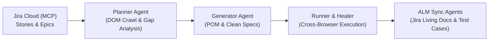

# Playwright Agentic Test Automation

> **Spec-Driven Automated Quality Engineering Assembly Line** integrating Jira Cloud, MCP Servers, Playwright CLI, Page Object Model (POM), and AI-Augmented Testing Agents.

---

## 🚀 Overview

This repository houses an enterprise-grade agentic test automation framework for [Falguni Handcraft](https://falgunishandcraft.com/), an artisanal jewelry e-commerce web application. 

The framework operates via an **Agentic Assembly Line** architecture that translates business user stories and Jira requirements directly into robust, maintainable, and self-healing Playwright automated test suites.



---

## 🏗️ Project Architecture

```text
playwright-AgenticTestAutomation/
├── .agents/
│   └── skills/
│       ├── core-skills/             # Core architectural & testing skills
│       └── playwright-cli/          # Browser automation, snapshots & video guides
├── .github/
│   └── agents/                      # Specialized agent prompt definitions
│       ├── assembly_line_request.agent.md
│       ├── playwright-test-planner.agent.md
│       ├── playwright-test-generator.agent.md
│       ├── playwright-test-healer.agent.md
│       ├── core_requests/           # Step-by-step agent workflow templates
│       ├── review_agents/           # Compliance and token efficiency reviewers
│       └── sync_alm_agents/         # Jira & SpiraPlan ALM synchronization agents
│           ├── jira_requirement.agent.md
│           └── jira_test_case_creator.agent.md
├── page_objects/                    # Encapsulated Page Object Model (POM) classes
│   ├── AddToCartPage.ts             # Catalog browsing, filtering & Add-to-Cart
│   └── CartVerify.ts                # Slide-over cart drawer & item verification
├── tests/                           # Focused Playwright test specifications
│   ├── Kanban-2-addToCart.spec.ts   # Category filtering & item addition
│   └── Kanban-5-verifyCart.spec.ts  # Cart drawer, item details & price assertions
├── test-artifacts/                  # Living documentation & BDD specifications
│   ├── Kanban-2-addToCart.feature
│   ├── Kanban-2_testStrategy.md
│   ├── Kanban-5-verifyCart.feature
│   ├── Kanban-4-verifyCart_testStrategy.md
│   └── TC-kanban 5-plan.md
├── playwright.config.ts             # Playwright test configuration (multi-browser)
├── package.json                     # Dependencies & project scripts
└── README.md                        # Project documentation
```

---

## ⚡ The Agentic Assembly Line

The framework operates in coordinated, sequential stages:

### 1. Test Planning & Gap Analysis (`playwright-test-planner`)
* Fetches user stories, steps, and acceptance criteria from Jira via the Jira MCP server.
* Performs live application crawls using `playwright-cli` to inspect DOM hierarchy, animations, and states.
* Cross-references Jira criteria against live DOM to identify requirement gaps (e.g., missing preconditions, drawer modal vs. URL route changes).
* Generates comprehensive testing strategy reports and Gherkin BDD feature files (`test-artifacts/`).

### 2. Test Generation & POM Mapping (`playwright-test-generator`)
* Adheres to the **Strict Zero-Raw-Selector Policy**: Every interaction and assertion must map to dedicated methods in `./page_objects/`.
* Dynamically creates/updates Page Objects with resilient locators and explicit assertions.
* Emits clean, readable test specs with mandatory `// Created By AI` accountability tags.

### 3. Execution & Self-Healing (`playwright-test-healer`)
* Runs the test suite across Chromium, Firefox, and WebKit engines.
* Captures failure context, inspects DOM discrepancies, and alerts/fixes broken locator logic.

### 4. ALM Synchronization (`sync_alm_agents`)
* **`jira-requirement-updater`:** Syncs validated BDD Gherkin scenarios back into Jira Stories (e.g. `KANBAN-5`) as Living Documentation.
* **`jira-test-case-creator`:** Generates physical Test Case issues (e.g. `KANBAN-7`) under the parent Epic (e.g. `KANBAN-4`) with step-by-step procedures and links to stories.

---

## 🛠️ Prerequisites & Setup

### Prerequisites
* [Node.js](https://nodejs.org/) (v18.x or v20.x recommended)
* npm (bundled with Node.js)

### Installation
Clone the repository and install all dependencies:

```bash
git clone https://github.com/Shawoncse/playwright-AgenticTestAutomation.git
cd playwright-AgenticTestAutomation
npm install
```

Install the Playwright browser binaries:

```bash
npx playwright install
```

---

## 🧪 Running Tests

### Run All Tests Across All Browsers
```bash
npx playwright test
```

### Run a Specific Test Specification
```bash
npx playwright test tests/Kanban-5-verifyCart.spec.ts
```

### Run Tests in Headed Mode (Watch Browser UI)
```bash
npx playwright test --headed
```

### Run on a Single Browser
```bash
npx playwright test --project=chromium
```

### View Interactive HTML Test Report
```bash
npx playwright show-report
```

---

## 📋 Jira Traceability Matrix

| Epic / Feature | Jira Story | Test Case | Status | Test Spec |
| :--- | :--- | :--- | :--- | :--- |
| **KANBAN-1** (*Add product Cart*) | [KANBAN-2](https://shawoncse.atlassian.net/browse/KANBAN-2) | [Scenario-001 & 002](file:///c:/Users/Shawon/OneDrive/Documents/GitHub/playwright-AgenticTestAutomation/test-artifacts/Kanban-2-addToCart.feature) | Passed ✅ | [`tests/Kanban-2-addToCart.spec.ts`](file:///c:/Users/Shawon/OneDrive/Documents/GitHub/playwright-AgenticTestAutomation/tests/Kanban-2-addToCart.spec.ts) |
| **KANBAN-4** (*Verify Cart*) | [KANBAN-5](https://shawoncse.atlassian.net/browse/KANBAN-5) | [KANBAN-7](https://shawoncse.atlassian.net/browse/KANBAN-7) | Passed ✅ | [`tests/Kanban-5-verifyCart.spec.ts`](file:///c:/Users/Shawon/OneDrive/Documents/GitHub/playwright-AgenticTestAutomation/tests/Kanban-5-verifyCart.spec.ts) |

---

## 🛡️ Strict Compliance Rules

1. **Zero Raw Selectors in Test Specs:** Spec files must never contain direct CSS, XPath, or raw locator queries. All locators reside inside Page Object classes under `page_objects/`.
2. **Accountability Tag:** Generated automation files must feature `// Created By AI` on Line 1.
3. **Focused Video-Scope Tests:** Test scenarios are kept concise and deterministic to optimize execution speed for video demonstration and CI/CD pipelines.

---

## 📄 License
ISC
